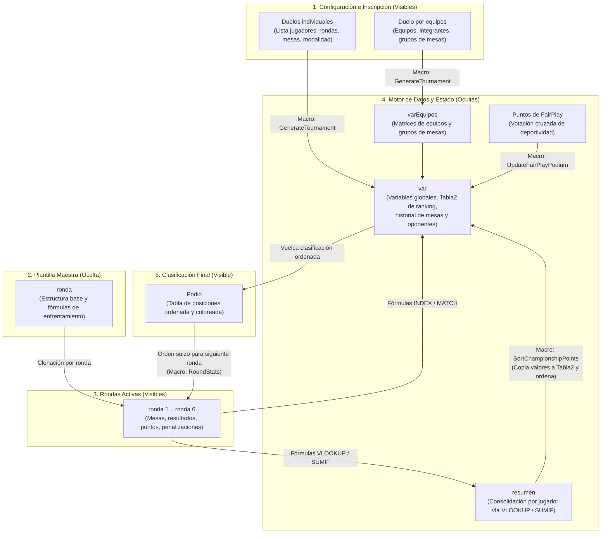
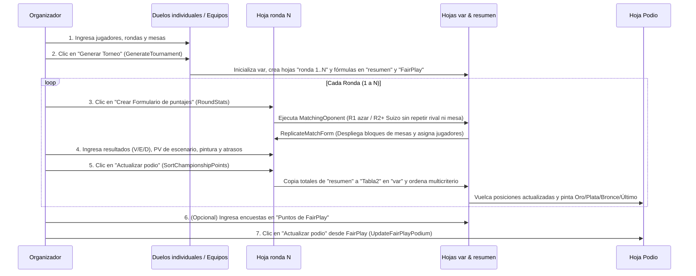

# Estudio Técnico y Funcional del Libro Excel: Torneo / Liga MESBG

**Archivo analizado:** `Liga, Integrantes en mesa individual_18-11-2024_ EMPAREJADOS.xlsm`  
**Tipo de archivo:** Libro de Excel habilitado para macros (`.xlsm`)  
**Propósito:** Sistema automatizado de gestión de torneos y ligas de *Middle-earth Strategy Battle Game (MESBG / Señor de los Anillos)* (Comunidad *Roble y Acero*), con soporte para **Duelos Individuales**, **Duelos por Parejas** y **Duelos por Equipos**, emparejamiento suizo (Swiss system), control de historial de mesas/oponentes, penalizaciones, Fair Play y cálculo de podio.

---

## 1. Arquitectura General del Libro (14 Hojas)

El libro está compuesto por **14 hojas de cálculo**, divididas en **9 hojas visibles** (interfaz de operación del organizador) y **5 hojas ocultas** (motor de cálculo, plantillas y almacenamiento de estado).



### Inventario de Hojas

| # | Nombre de Hoja | Estado | Rol en el Sistema |
| :--- | :--- | :--- | :--- |
| 1 | `Duelo por equipos` | Visible | Panel de configuración e inscripción para torneos por equipos. |
| 2 | `Duelos individuales` | Visible | Panel de configuración e inscripción para torneos individuales o por parejas. |
| 3 | `ronda` | **Oculta** | Plantilla maestra que se clona para crear las hojas `ronda 1` a `ronda N`. |
| 4 | `varEquipos` | **Oculta** | Almacena la matriz de equipos/integrantes y los grupos de mesas para validaciones dinámicas (`INDIRECT`). |
| 5 | `Podio` | Visible | Clasificación general ordenada (Oro, Plata, Bronce y último lugar activo). |
| 6–11 | `ronda 1` a `ronda 6` | Visibles | Hojas operativas de cada ronda del torneo actual (6 rondas configuradas). |
| 12 | `var` | **Oculta** | Base de datos interna: variables de control, tabla estructurada `Tabla2` (usada para ordenar el ranking) y matriz histórica de mesas y oponentes por ronda. |
| 13 | `resumen` | **Oculta** | Sábana de consolidación que extrae automáticamente mediante fórmulas los resultados de cada jugador en todas las rondas. |
| 14 | `Puntos de FairPlay` | **Oculta** | Módulo de votación de deportividad (Fair Play) enfrentamiento por enfrentamiento. |

> [!NOTE]
> **Estado de los datos en el archivo actual:** El archivo tiene cargado un torneo individual (`Duelos individuales`) de **24 jugadores**, **12 mesas** y **6 rondas**. Las rondas **1 a 4** tienen resultados registrados (con 2 abandonos de torneo en ronda 4: *Fernando Leiva* y *Tomas Daccarett*), la **ronda 5** tiene los emparejamientos generados para los 22 jugadores activos pendientes de resultados, y la **ronda 6** aún no ha sido emparejada.

---

## 2. Estudio Detallado de Hojas y Fórmulas

*(Nota: Las fórmulas se muestran con el nombre de función estándar de Excel en inglés almacenado en el XML y su equivalente en español).*

### 2.1. Hoja `Duelos individuales` (Visible)
Es la pantalla de inicio para torneos 1v1 o parejas.

* **Parámetros de configuración:**
  * `F3`: Número de rondas (`6`).
  * `F4`: Número de mesas (`12`).
  * `F5:H5` (combinada): Tipo de torneo (`"Duelos individuales"` o `"Duelos por parejas"`, validado desde `var!D3:D4`).
* **Listado de jugadores:** Columna `B` desde `B4` hacia abajo (`B4:B27` con 24 jugadores).
* **Fórmulas:**
  * **Contador total de inscritos (`B2`):**
    ```excel
    =COUNTA(B4:B150)   // Español: =CONTARA(B4:B150)
    ```
  * **Título dinámico de lista (`B3`):**
    ```excel
    =IF(F5="Duelos individuales","Lista de participantes","Lista de equipos")
    ```
  * **Numeración automática de filas (`A9:A70`):** (`A4:A8` tienen constantes `1` a `5`, y desde `A9` es dinámico):
    ```excel
    =IF(B9<>"",A8+1,"")
    ```

---

### 2.2. Hoja `Duelo por equipos` (Visible)
Pantalla de inicio para torneos por equipos (4v4, etc.).

* **Parámetros de configuración:**
  * `F3`: Número de rondas (`4`).
  * `F4`: Número de mesas totales (`18`).
  * `F5`: Número de equipos (`4`).
  * `F6`: Integrantes por equipo (`4`).
  * `F7`: Número de mesas por equipo (`4`).
* **Fórmulas:**
  * `B2`: `=COUNTA(B4:B150)` (cuenta el total de celdas ocupadas en la columna B, incluyendo cabeceras de equipo e integrantes).
* **Botones asociados:**
  1. *Generar formulario ingreso de equipos* $\rightarrow$ macro `CreaFormularioEquipos` (crea bloques en la columna `B` con `Nombre_equipo_i` y sus `Integrante 1..N`).
  2. *Generar Torneo* $\rightarrow$ macro `GenerateTournament`.
  3. *Formatear plantilla* $\rightarrow$ macro `ClearAll`.

---

### 2.3. Hoja `ronda` (Oculta - Plantilla) y Hojas `ronda 1` a `ronda 6` (Visibles)
Cada hoja de ronda tiene un identificador de número de ronda en la celda `C1` (`1`, `2`, ..., `6`) y se divide en **dos grandes secciones horizontales**:

1. **Formulario de Mesas y Partidas Individuales (Columnas `A` a `T`):**
   Cada mesa ocupa un bloque vertical de **7 filas** (el primero en filas `5` a `9`, el segundo en `12` a `16`, el tercero en `19` a `23`, sumando `+7` filas por mesa).
2. **Resumen de Enfrentamientos de Equipos (Columnas `V` a `AN`):**
   Se utiliza únicamente cuando el torneo es por equipos (`var!$E$3 = "si"`).

#### A. Estructura y Fórmulas de cada Bloque de Mesa (Ejemplo: Mesa 1 en Filas 5 a 9)

* **Cabeceras del bloque:**
  * `A6:A7` (combinada): Nombre de la mesa asignada por macro (ej. `"Mesa 11"`).
  * `C8` y `C9`: Nombre del Jugador 1 y Jugador 2 (rellenados por la macro `RoundStats`).
  * `B8` y `B9`: Nombre del Equipo 1 y Equipo 2 (oculto en torneos individuales).

* **Tabla de Fórmulas por Jugador (Filas 8 y 9):**

| Columna | Campo | Entrada / Fórmula en Fila 8 (Jugador 1) | Lógica de Negocio |
| :--- | :--- | :--- | :--- |
| **`A8`** | N° de mesa | `=A6` | Repite el nombre de la mesa en las dos filas de jugadores para permitir búsquedas `INDEX/MATCH` por fila. |
| **`D8`** | Pintura (Cumple S/N) | *Input manual* (`"s"` / `"n"`) | Indica si el ejército cumple el requisito de pintado. |
| **`E8`** | Puntaje Pintura | `=IF(D8="s","0",IF(D8="n",IF(var!$E$3="si",-2,-1),"0"))` | Si no cumple (`"n"`), penaliza con **`-2`** en torneo por equipos (`var!$E$3="si"`) o **`-1`** en individual. Si cumple o está vacío, devuelve `"0"`. |
| **`F8`** | Minutos atraso | *Lista desplegable* (`N/A`, `< 10 min`, `10 - 20 min`, `> 20 min`) | Tiempo de retraso al presentarse a la mesa. |
| **`G8`** | Puntaje Atraso | `=IF(OR(F8="< 10 min",F8="N/A"),"0",IF(OR(F8="10 - 20 min",F8="> 20 min"),-1,"0"))` | Si el atraso es `10 - 20 min` o `> 20 min`, penaliza con **`-1`**. |
| **`H8`** | Rendición S/N | *Input manual* (`"s"` / `"n"`) | Indica si el jugador se rindió durante la partida. |
| **`I8`** | Abandono Partida S/N | *Input manual* (`"s"` / `"n"`) | Indica si el jugador abandonó la partida (o no se presentó tras `> 20 min`). |
| **`J8`** | Validador de Atraso Crítico | `=IF(AND(F8="> 20 min",I8<>"s"),"error","")` | Si un jugador llega con **`> 20 min`** de atraso, reglamentariamente pierde por abandono de partida. Si `I8` no se marca como `"s"`, muestra `"error"` y activa **formato condicional rojo** en `I8:J9`. |
| **`K8`** | Abandono Torneo S/N | *Input manual* (`"s"` / `"n"`) | Retiro definitivo del jugador del torneo (lo excluye de rondas futuras y lo envía al fondo del podio). |
| **`L8`** | Resultado partida (`V`/`E`/`D`) | `=IF(OR(H8="s",H9="s",I8="s",I9="s",K8="s",K9="s"),IF(OR(H8="s",I8="s",K8="s"),"d","v"),"")` | Si alguno de los dos jugadores se rinde o abandona (`H`, `I` o `K` = `"s"`), asigna automáticamente **`"d"`** (Derrota) al infractor y **`"v"`** (Victoria) a su rival. Si es partida normal, queda vacío `""` para que el organizador escriba manualmente `V`, `E` o `D`. |
| **`M8`** | Puntos de torneo | `=IFERROR(IF(L8="V",Q8,IF(L8="E",R8,IF(L8="D",S8,0))),0)` | Asigna los puntos de torneo según el resultado en `L8` leyendo las columnas auxiliares `Q8` (Victoria), `R8` (Empate) o `S8` (Derrota). |
| **`N8`** | Puntos de victoria a favor (Escenario) | `=IF(OR(H8="s",H9="s",I8="s",I9="s"),IF(OR(H8="S",I8="s"),0,IF(OR(H8="n",H8=""),T8,"")),"0")` | Si hay rendición/abandono, otorga **`0`** PV al que abandona y el puntaje automático `T8` (`6` o `12` PV) al ganador. En partida normal, el organizador sobrescribe la celda con los PV logrados en el escenario. |
| **`O8`** | Diferencia de PV | `=N8-N9` (y en `O9`: `=N9-N8`) | Diferencia neta de Puntos de Victoria del enfrentamiento. |

* **Columnas Auxiliares de Reglas de Puntuación (`Q`, `R`, `S`, `T`):**
  Calculan cuántos puntos corresponden según la modalidad configurada en `'Duelos individuales'!$F$5`:
  * **`Q8` (Puntos por Victoria):**
    ```excel
    =IF(AND('Duelos individuales'!$F$5="Duelos individuales",L8="v"),3,
     IF(AND(L8="v",ABS(O8)>=6),5,
     IF(AND(L8="v",ABS(O8)<6),4,0)))
    ```
    * En modo `"Duelos individuales"`: Victoria = **3 pts**.
    * En otro modo (`"Duelos por parejas"` / Equipos): Victoria Masacre ($\text{Dif. PV} \ge 6$) = **5 pts**; Victoria Marginal ($\text{Dif. PV} < 6$) = **4 pts**.
  * **`R8` (Puntos por Empate):**
    ```excel
    =IF('Duelos individuales'!$F$5="Duelos individuales",1,
     IF('Duelos individuales'!$F$5="Duelos por parejas",2,0))
    ```
    * Individual = **1 pt**; Parejas/Equipos = **2 pts**.
  * **`S8` (Puntos por Derrota):**
    ```excel
    =IF(AND('Duelos individuales'!$F$5="Duelos individuales",L8="d"),0,
     IF(AND(L8="d",H8="s"),-1,
     IF(AND(L8="d",ABS(O8)<6),1,
     IF(AND(L8="d",ABS(O8)>=6),0,0))))
    ```
    * Individual = **0 pts**.
    * Parejas/Equipos: Derrota por rendición (`H8="s"`) = **-1 pt**; Derrota Marginal ($\text{Dif. PV} < 6$) = **1 pt**; Derrota Masacre ($\text{Dif. PV} \ge 6$) = **0 pts**.
  * **`T8` (PV de Escenario por defecto ante abandono rival):**
    ```excel
    =IF('Duelos individuales'!$F$5="Duelos individuales",6,
     IF('Duelos individuales'!$F$5="Duelos por parejas",12,0))
    ```

> [!IMPORTANT]
> **Particularidad detectada en los datos de `ronda 1` a `ronda 4`:** Aunque `'Duelos individuales'!$F$5` tiene el valor `"Duelos individuales"` (que calcula `Q=3, R=1, S=0`), el organizador del torneo utilizó en la práctica la escala expandida (**5 / 4 / 2 / 1 / 0**) sobrescribiendo manualmente los valores en la columna `M` (`Puntos de torneo`) cuando hubo victorias por 4 o 5 puntos, empates de 2 puntos o derrotas ajustadas de 1 punto.

#### B. Sección de Duelos por Equipos en Hojas de Ronda (Columnas `V` a `AN`)
* `V8` y `Z8`: Equipos enfrentados (`Equipo 1` V/S `Equipo 2`).
* `W8` y `AA8`: Color asignado (`Rojo` o `Azul`) para el proceso de cruce de listas.
* `X8:X...` y `AB8:AB...`: Integrantes de cada equipo (listas desplegables dependientes mediante `=INDIRECT(...)` del nombre del equipo en `V` o `Z`).
* `AC8`: Grupo de mesas asignado (ej. `Mesas_1_a_4`).
* `AD8:AD...`: Mesa individual específica dentro del grupo (lista desplegable con `=INDIRECT(...)`).
* **Fórmulas de asignación de Color por clasificación previa (`AG8:AN8`, generadas por macro desde Ronda 2):**
  * `AG8:AI8`: Buscan en `Podio!$F$6:$J$...` los Puntos de Torneo (`col 3`), Dif. de PV (`col 4`) y PV a favor (`col 5`) del `Equipo 1` (`V8`).
  * `AK8:AM8`: Buscan los mismos 3 valores para el `Equipo 2` (`Z8`).
  * `AJ8` (Color Equipo 1): Compara jerárquicamente quién va más arriba en el podio para darle el color `"Rojo"` al superior, `"Azul"` al inferior, o `"blanco"` si están totalmente empatados:
    ```excel
    =IF(AG8>AK8,"Rojo",IF(AG8=AK8,IF(AH8>AL8,"Rojo",IF(AH8=AL8,IF(AI8>AM8,"Rojo",IF(AI8=AM8,"blanco","Azul")),"Azul")),"Azul"))
    ```
  * `AN8` (Color Equipo 2):
    ```excel
    =IF(AJ8="Rojo","Azul",IF(AJ8="Azul","Rojo","blanco"))
    ```
  * `AJ5` (Contador de empates de color):
    ```excel
    =COUNTIF($AJ$8:$AJ$500,"blanco")
    ```
    Si `AJ5 > 0`, la macro alerta al organizador para que asigne manualmente los colores de los equipos empatados.

---

### 2.4. Hoja `resumen` (Oculta)
Actúa como motor relacional entre las hojas `ronda 1..N` y la tabla de posiciones.

* **Fila 1 (`H1:R1`):** Índices numéricos de columna para `VLOOKUP` (`H1=2, I1=3, J1=4, K1=5, L1=6, M1=7, N1=9, O1=10, P1=11, Q1=12, R1=13`). Nótese el salto de `7` a `9` en `N1` (`=M1+2`) para saltarse la columna `J` (`error`) de las hojas de ronda.
* **Columnas de Totales Acumulados por Jugador (`A5:G28`):**
  * `A5`: Nombre del jugador.
  * `B5` (**Abandono torneo**): Verifica si abandonó en cualquiera de las 6 rondas:
    ```excel
    =IF(OR(N5="s",Z5="s",AL5="s",AX5="s",BJ5="s",BV5="s"),"s","")
    ```
  * `C5` (**Total penalización**): Suma los puntajes de pintura y atraso de las 6 rondas:
    ```excel
    =I5+K5+U5+W5+AG5+AI5+AS5+AU5+BE5+BG5+BQ5+BS5
    ```
  * `D5` (**Total puntos de torneo brutos**): Suma los puntos de torneo de las 6 rondas:
    ```excel
    =P5+AB5+AN5+AZ5+BL5+BX5
    ```
  * `E5` (**Total puntos de torneo final**):
    ```excel
    =D5-C5
    ```
  * `F5` (**Total Diferencia de puntos de victoria**):
    ```excel
    =R5+AD5+AP5+BB5+BN5+BZ5
    ```
  * `G5` (**Total Puntos de victoria a favor**):
    ```excel
    =Q5+AC5+AO5+BA5+BM5+BY5
    ```
* **Bloques por Ronda (`H5:S5` para Ronda 1, desplazándose `+12` columnas por cada ronda hasta `CA`):**
  * En **Torneo Individual**, extrae los datos de cada jugador con `VLOOKUP` (`BUSCARV`) sobre el rango `'ronda X'!$C$5:$O$86`:
    ```excel
    =IFERROR(VLOOKUP($A5,'ronda 1'!$C$5:$O$86,$P$1,0),0)
    ```
  * En **Torneo por Equipos** (`var!$E$3="si"`), la macro `GenerateSheetResumen` reemplaza los `VLOOKUP` por `SUMIF` (`SUMAR.SI`) buscando el nombre del equipo en la columna `B` de cada ronda (`'ronda X'!$B$8:$B$...`) y sumando los puntos de todos sus integrantes en las columnas `E`, `G`, `M`, `N` y `O`.

---

### 2.5. Hoja `var` (Oculta)
Es el centro de control de estado de las macros, listas de validación, tabla de ordenamiento y matriz de emparejamientos.

1. **Listas para Validación de Datos (`A1:E6`):**
   * `A3:A6`: Tiempos de penalización (`N/A`, `< 10 min`, `10 - 20 min`, `> 20 min`).
   * `C3:C4`: Condicional (`S`, `N`).
   * `D3:D4`: Tipos de torneo (`Duelos individuales`, `Duelos por parejas`).
   * `E3`: Bandera clave de modalidad por equipos (`"si"` cuando es torneo por equipos, vacío `""` cuando es individual).
2. **Variables de Estado del Torneo (`K1:Q8`):**
   * `L1`: Total de rondas (`6`).
   * `L2`: Total de mesas (`12`).
   * `L3:Q3`: Número de ronda (`1` a `6`).
   * `L5:Q5`: Jugadores activos por ronda (`24, 24, 22, 22, 22`).
   * `L6`: Bandera `Guardo lista?` (`"s"` tras ejecutar `GenerateTournament`).
   * `L7:Q7`: Bandera `emparejo jugadores` por ronda (`"s"` tras ejecutar `RoundStats`).
   * `L8:Q8`: Bandera `actualizo podio?` por ronda (`"s"` tras ejecutar `SortChampionshipPoints`). Evita emparejar la ronda $N$ si no se ha actualizado el podio de la ronda $N-1$.
3. **Contadores de `Tabla2` (`A10:B10`):**
   * `A10` (Total inscritos): `=COUNTA(Tabla2[Jugadores])` $\rightarrow$ `24`.
   * `B10` (Total abandonos): `=COUNTIF(Tabla2[Abandona torneo],"s")` $\rightarrow$ `2`.
4. **Tabla Estructurada `Tabla2` (`A11:H49`):**
   * Columnas: `Jugadores`, `Abandona torneo`, `Penalizaciones`, `Puntos de torneo`, `Puntos de torneo final`, `Diferencia de puntos de victoria`, `Puntos de victoria a favor`, `Puntos de Fair Play`.
   * Recibe por macro los valores calculados en `resumen`, ejecuta el `.Sort` multicriterio de Excel y copia el resultado hacia `Podio`.
5. **Matriz de Historial de Mesas y Oponentes (`K11:W35`):**
   * `K12:K35`: Lista fija de jugadores en su orden original de inscripción.
   * `L12:Q35` (`mesa ronda 1` a `mesa ronda 6`): Fórmulas `INDEX/MATCH` (`INDICE/COINCIDIR`) que detectan automáticamente en qué mesa jugó cada participante en cada ronda:
     ```excel
     =IFERROR(INDEX('ronda 1'!$A$5:$C$200,MATCH(K12,'ronda 1'!$C$5:$C$200,0),1),"")
     ```
     *(En modo equipos, usa una fórmula con `VLOOKUP` sobre las columnas `V:AC` y `Z:AC` para obtener el grupo de mesas).*
   * `R12:W35` (`oponente 1` a `oponente 6`): Valores escritos directamente por la macro de emparejamiento (`MatchingOponent`) que registran contra quién jugó cada participante en cada ronda para impedir enfrentamientos repetidos.

---

### 2.6. Hoja `Puntos de FairPlay` (Oculta)
Gestiona la puntuación de deportividad otorgada al finalizar el torneo mediante encuestas.

* **Escala de Conversión (`K4:L8`):**
  * Posición `1` $\rightarrow$ `4` pts
  * Posición `2` $\rightarrow$ `3` pts
  * Posición `3` $\rightarrow$ `2` pts
  * Posición `4` $\rightarrow$ `1` pt
* **Tabla de Ingreso (`B6:E149`):**
  Cada jugador tiene un bloque de `totalRondas` filas (6 filas por jugador):
  * `B6:B11` (combinada): Nombre del jugador evaluador.
  * `C6:C11`: `Posicion otorgada` (input manual donde se ingresa el lugar `1..4` que el jugador le dio a ese oponente en la encuesta).
  * `D6:D11` (`Puntaje`): Convierte la posición otorgada en puntos:
    ```excel
    =IFERROR(VLOOKUP(C6,$K$5:$L$8,2,0),0)
    ```
  * `E6:E11` (`Oponentes`): Busca automáticamente en la matriz de `var!$K$12:$W$35` el oponente que enfrentó ese jugador en la ronda $j$ (columnas `8` a `13` de la matriz):
    ```excel
    =VLOOKUP(B6,var!$K$12:$W$35,8,0)
    ```
* **Ranking Fair Play (`G5:H29`):**
  Suma todos los puntos recibidos por cada jugador cuando aparece como oponente en la columna `E`:
  ```excel
  =SUMIF($E$6:$E$150,G6,$D$6:$D$150)   // Español: =SUMAR.SI($E$6:$E$150;G6;$D$6:$D$150)
  ```

---

### 2.7. Hoja `varEquipos` (Oculta)
Almacena las listas dinámicas cuando se juega en modalidad de equipos:
* `A3` (Total integrantes): `=COUNTIF(C4:AF23,"<>")`
* `B3` (Total equipos): `=COUNTIF(C3:AF3,"<>")`
* `C3:AF3`: Nombres de los equipos (con espacios reemplazados por `_`), y debajo de cada columna (`fila 4` hacia abajo) sus integrantes, convertidos en rangos con nombre por VBA.
* `B25` (Total grupos de mesas): `=COUNTIF(C25:AF25,"<>")`
* `C25:AF25`: Nombres de los grupos de mesas (ej. `Mesas_1_a_4`), y debajo de cada uno los números de mesa correspondientes.

---

### 2.8. Hoja `Podio` (Visible)
Muestra la tabla de clasificación para los jugadores.
* `E5:K5`: Cabeceras (`Posicion`, `Jugador`/`Equipo`, `Abandono torneo`, `Puntos de torneo`, `Diferencia de puntos de victoria`, `Puntos de victoria a favor`, `Puntos de Fair Play`).
* **Fórmula en cabecera `F5`:**
  ```excel
  =IF('Duelos individuales'!F5:H5="Duelos individuales","Jugador","Equipo")
  ```
* **Filas `E6:K29`:** Valores planos volcados por la macro `SortChampionshipPoints` (o `UpdateFairPlayPodium`) tras ordenar `Tabla2` en la hoja `var`.
* **Código de colores aplicado por macro:**
  * 1° Lugar (`E6:K6`): Oro `RGB(255, 215, 0)`
  * 2° Lugar (`E7:K7`): Plata `RGB(215, 215, 215)`
  * 3° Lugar (`E8:K8`): Bronce `RGB(205, 127, 50)`
  * Último jugador activo sin abandono (`Offset(activePlayers, 0)`): Café/Cuchara de palo `RGB(163, 94, 66)`

---

## 3. Motor de Automatización VBA (`Módulo1`)

Todo el código VBA reside en **`Módulo1`** (los módulos de hoja `Hoja1..Hoja18` y `ThisWorkbook` no contienen código). A continuación se detalla el funcionamiento de sus procedimientos y algoritmos:

### 3.1. Ciclo de Vida del Torneo y Botones



### 3.2. Algoritmo de Emparejamiento y Asignación de Mesas (`MatchingOponent`)

1. **Control de Jugadores Impares (`BYE`):**
   * Calcula `activePlayers = totalplayers - abandonos` (`var!B10`).
   * Si `activePlayers` es impar, redimensiona el vector de jugadores activos y agrega un jugador virtual `"BYE"` en la última posición.
2. **Ronda 1 (Aleatoria):**
   * Baraja aleatoriamente el vector de jugadores y el vector de mesas usando `RandomizeVector` (algoritmo de intercambio con `Application.RandBetween`).
   * Empareja consecutivamente `(vector(2*i), vector(2*i+1))` en la mesa `table(i)` y registra el oponente en la hoja `var`.
3. **Ronda 2 en adelante (Sistema Suizo con Restricción de Oponentes y Mesas):**
   * Lee el orden actual de clasificación (`ladder`) desde `Podio!F6:G...` (excluyendo a los que abandonaron el torneo, que ya están al final de la tabla).
   * **Búsqueda Greedy de Oponente:** Para cada jugador `i` desde el 1° hacia abajo que aún no tenga pareja (`pairedPlayer`), busca al siguiente jugador disponible `j` más cercano en la tabla verificando en la matriz `pastTables` (`var!K12:W35`) que **`i` y `j` no se hayan enfrentado en ninguna ronda anterior** (`1 To nround`).
   * **Resolución de Rezagados (Fallback líneas 707–805):** Si al final de la tabla quedan jugadores sin emparejar porque todos los restantes ya habían jugado entre sí en rondas previas, un segundo bucle los fuerza a emparejarse entre los no asignados para no dejar mesas vacías.
   * **Asignación Aleatoria de Mesas sin Repetición (`While flag4`, líneas 837–961):**
     * Baraja el vector de mesas (`RandomizeVector(table)`) y verifica para cada pareja `(Jugador 1, Jugador 2)` el historial de mesas jugadas en `pastTables` (`var!L12:Q35`).
     * Si algún jugador repite una mesa en la que ya jugó en rondas anteriores, vuelve a barajar todas las mesas e intenta de nuevo.
     * Incluye una válvula de seguridad (`emergencyCounter = 30000` iteraciones): si tras 30.000 sorteos es matemáticamente imposible que nadie repita mesa, acepta la última distribución aleatoria.

### 3.3. Criterios de Ordenamiento del Podio (`SortChampionshipPoints` y `UpdateFairPlayPodium`)

Excel ordena la tabla estructurada `var!Tabla2` aplicando llamadas sucesivas a `.Sort` (de menor a mayor jerarquía), resultando en el siguiente orden de prioridad:

1. **`Abandona torneo`** (Ascendente: primero los activos `""`, al fondo los que tienen `"s"`).
2. **`Puntos de torneo final`** (Descendente: mayor puntaje neto).
3. **`Diferencia de puntos de victoria`** (Descendente: mejor diferencial de PV).
4. **`Puntos de victoria a favor`** (Descendente: más puntos de escenario anotados).
5. **`Puntos de Fair Play`** (Descendente: solo cuando se ejecuta `UpdateFairPlayPodium` desde la hoja `Puntos de FairPlay`).

---

## 4. Hallazgos Técnicos y Detalles a Considerar (Auditoría del Excel)

Al estudiar las fórmulas y el código VBA para una eventual migración o mejora, destacan los siguientes puntos técnicos:

> [!WARNING]
> **1. Signo de las Penalizaciones en `resumen!E5` (`=D5-C5`):**
> En las hojas de ronda, las fórmulas de penalización por pintura (`E8`) y atraso (`G8`) devuelven valores **negativos** (`-1` o `-2`). En la hoja `resumen`, la columna `C` (`total penalizacion`) suma esas celdas (dando un número negativo, ej. `-1`), pero la columna `E` (`total puntos de torneo final`) tiene la fórmula `=D5-C5`. Al restar un número negativo (`Puntos - (-Penalización)`), **las penalizaciones sumarían puntos en lugar de restarlos**. Para que reste correctamente debería ser `=D5+C5` (o bien que las penalizaciones sean positivas).

> [!CAUTION]
> **2. Algoritmo Suizo sin Backtracking ante Bloqueos Finales:**
> En `MatchingOponent`, el emparejamiento suizo es puramente *greedy* (voraz) de arriba hacia abajo. Si los últimos 2 jugadores de la tabla ya se enfrentaron entre sí en una ronda anterior, el primer bucle los deja sin pareja y el bucle de *fallback* (líneas 707–805) termina emparejándolos igualmente entre sí (repitiendo rival) en vez de deshacer el penúltimo emparejamiento (*backtracking* / *swap*) para evitar la repetición.

* **3. Pequeño bug tipográfico al validar mesas con `BYE` (línea 899 de `Módulo1`):**
  Al comprobar las mesas pasadas del Jugador 2 (`Match(t, 1)`), la condición dice `If pastTables(temp2, 1) = Match(t, 1) Or Match(t, 0) = "BYE" Then` (evalúa `Match(t, 0)` en lugar de `Match(t, 1)`).
* **4. Sobrescritura de Fórmulas por Diseño en Hojas de Ronda:**
  Las columnas `L` (`Resultado partida`) y `N` (`Puntos de victoria a favor`) contienen inicialmente fórmulas que evalúan si hubo rendición o abandono (`H`, `I`, `K`). Cuando se juega una partida normal, el usuario escribe encima de la celda (`V`/`E`/`D` y los puntos de victoria), **borrando la fórmula de esa celda**. Si luego se marca por error o corrección un abandono en `H`, `I` o `K`, esa fila ya no recalcula automáticamente a menos que se regenere la ronda.
* **5. Desconexión entre Modalidad Individual y Puntuación 5/4/2/1/0:**
  Las fórmulas en `Q8:S8` atan el sistema de puntuación de 3/1/0 a `"Duelos individuales"` y el sistema de 5/4/2/1/0 (con masacre por diferencia $\ge 6$ PV) a `"Duelos por parejas"`. En torneos individuales donde se desea usar el sistema de 5/4/2/1/0 (como ocurrió en este archivo del 18-11-2024), el organizador se vio obligado a sobrescribir a mano la columna `M` (`Puntos de torneo`) en cada mesa.
* **6. Errores `#N/A` en rondas aún no emparejadas en `resumen`:**
  En la hoja `resumen`, las columnas de `Pintura (Cumple criterio)` y `Atraso (minutos)` (`H`, `J`, `T`, `V`, ..., `BP`, `BR`) usan `VLOOKUP` sin `IFERROR`. Cuando una ronda aún no tiene jugadores asignados (como `ronda 6`), producen `#N/A`, aunque no rompen los totales porque los totales suman únicamente las columnas numéricas que sí están envueltas en `IFERROR(..., 0)`.
